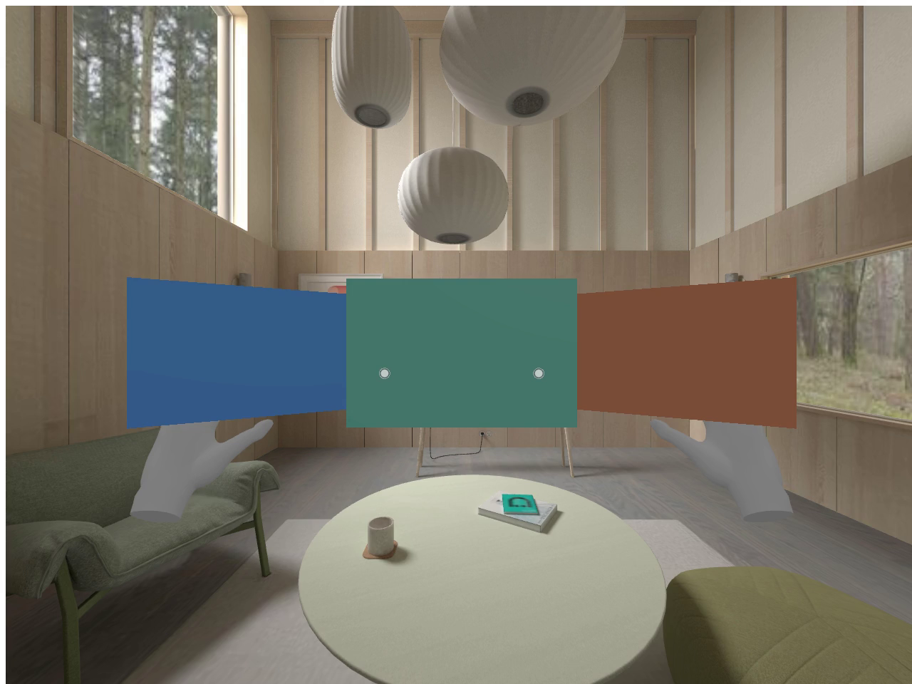
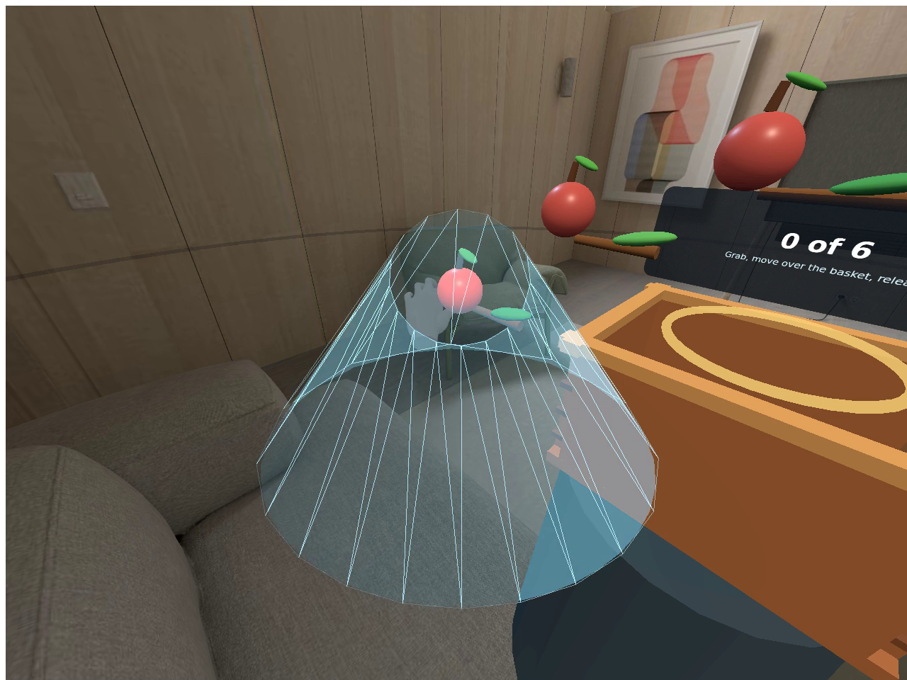
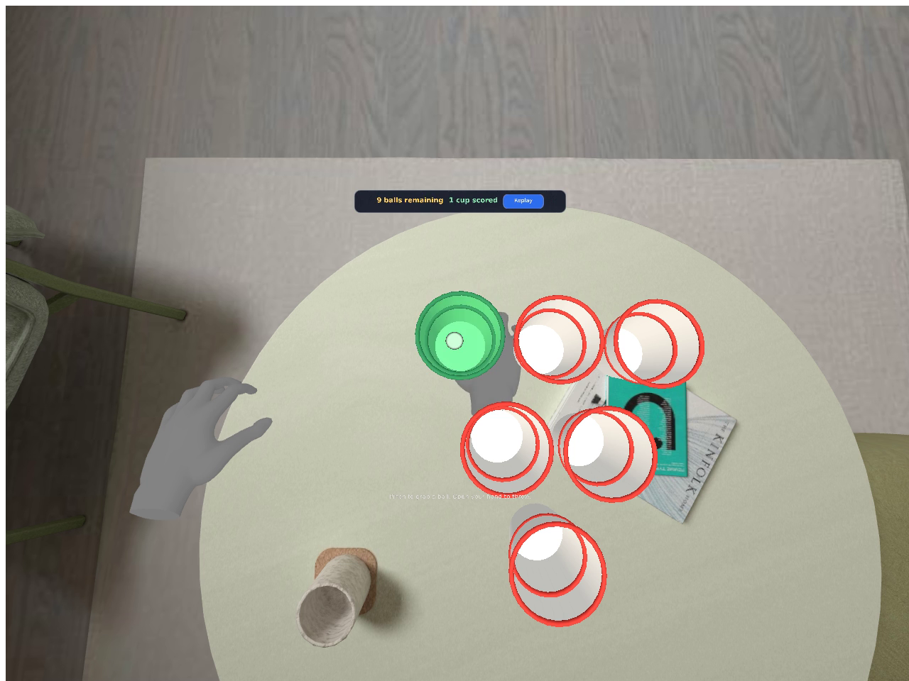
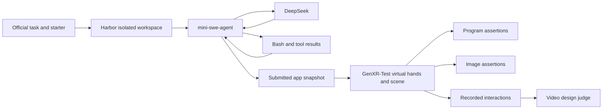

# GenXR-Bench Reproduction

**English** · [简体中文](README_CN.md)

Can a coding agent turn a spatial design brief into an XR application that responds correctly to a moving hand? This independent reproduction follows three tasks from the official App Generation Benchmark, from the first job to the frozen application, held-out tests and visual judgments. The authors' implementation and results are available in the [upstream repository](https://github.com/whuang37/genxr-bench/tree/ea31e2c2b23884f7ab810de31a755b273e996770) and [paper](https://arxiv.org/abs/2610.29014v2).

**Three apps were generated, submitted and launched. One received a complete, valid functional pass.** The other two each failed a required program assertion and had incomplete official evaluations. All four scheduled jobs and all three tasks remain in the release. [Results](results/cohort.csv) · [Job history](results/job-attempts.json)

## What the agent built

| Focus Mode | Orchard Reach | Digital Beerpong |
|---|---|---|
| [](media/focus-mode/focus-mode-left.mp4) | [](media/orchard-reach/orchard-reach-basket-left.mp4) | [](media/digital-beerpong/digital-beerpong-right.mp4) |

Select a frame to open its original recording. The three apps ask the user to move spatial work screens, guide fruit into a rehabilitation basket, and throw a ball with hand velocity. The ten recordings cover both successful interactions and failed tests. [Media and fingerprints](media/manifest.csv) · [Frozen application code](apps/snapshot-hashes.json)

## Benchmark and protocol

Huang and colleagues introduced 112 XR coding tasks, including 67 end-to-end applications. GenXR-Test drives head and hand actions in a simulated room. It checks scene state in code and sends selected screenshots to a visual judge. A separate ten-item review evaluates design from recordings. An app can visibly launch while failing an interaction requirement. [Paper, §§3–4](https://arxiv.org/html/2610.29014v2) · [Source walkthrough](docs/source-guide.md)



The three tasks were selected before generation, one per difficulty, in different domains and with at least one locally checkable behavior. Harbor 0.18.0 ran mini-swe-agent 2.4.6 against the official DeepSeek API. Responses identified the model as `deepseek-flash`. Thinking was enabled. We requested `xhigh`; the provider documents an effective level of `high`. Each task allowed up to 128 requests, 120 minutes and an estimated US$1.50, with zero automatic retries. The official prompt and Bash tool were retained. Held-out tests were mounted after generation. [Pinned configuration](config/protocol.json) · [Reproduction guide](docs/reproduce.md)

## Functional and visual results

| Task | Held-out evidence from the first actual generation | First official result | Web Auto raw design mean |
|---|---|---|---:|
| Focus Mode · easy | Both hands moved each of three panels more than 3 cm | valid · 2/2 · reward 1 | 3.50/5 |
| Orchard Reach · medium | The held apple moved 0 m where more than 0.10 m was required. Return-to-branch was never reached | invalid · effective reward unavailable | 2.60/5 |
| Digital Beerpong · hard | With either hand a fast throw travelled farther than a slow throw. The separate miss case found 0 tagged balls after one second where 1 was required | invalid · effective reward unavailable | 5.00/5 |

Image and design judgments use different evidence. Gemini 3.8 Flash returned **3 of 4** verdicts on independently captured image requests. Both Orchard basket verdicts were false. The Beerpong left-hand score was true. Its right-hand request received two HTTP 502 responses. A separate Gemini web Auto review of the right-hand images returned true: the cup turned green, balls remaining fell from 10 to 9 and the score rose from 0 to 1. [Image decisions](results/image-verdicts.json) · [First-run cases](evaluation/first-cases.csv)

The original API video route produced **0 of 3** Design Scores. The web interface did return ten ratings per app. All three raw means above are preserved. Each review contained reasons that conflicted with the footage, so all three evidence-accepted web means remain empty. For example, the Beerpong review cited the right-hand speed clip at 8 s as showing ball cleanup. An orange ball is visible in that frame. Auto exposes no fixed backend version or API video-processing record. [Scores and item-level evidence](results/web-design.json) · [8 s frame](media/digital-beerpong/digital-beerpong-velocity-right-16-last-recorded.png)

## Generation efficiency

| Task | Model turns | Bash results | Tokens | Agent time | Estimated USD | Approx. testing/editing |
|---|---:|---:|---:|---:|---:|---:|
| Focus Mode | 30 | 49 | 1,670,843 | 3m 42s | 0.02598 | 12/2 = 6.00 |
| Orchard Reach | 80 | 98 | 9,204,257 | 12m 46s | 0.17904 | 34/19 = 1.79 |
| Digital Beerpong | 117 | 133 | 16,725,934 | 19m 40s | 0.25033 | 36/39 = 0.92 |
| **Total** | **227** | **280** | **27,601,034** | **36m 08s** | **0.45535** | |

Each model turn had one dispatched request and one saved response. A turn can contain several Bash calls. Time sums the three generation intervals. Cost uses recorded token usage and the applicable price periods; itemized charges are unavailable. T/E uses turns with authored or executed tests divided by turns with edits and remains approximate. [Turn-level records](trajectories/) · [Definitions](docs/reproduce.md#metrics)

## How to read the result

Orchard's first scheduled job stopped during local HTTP header serialization, before any model request. Its second job was its first actual generation. First scheduled jobs delivered **2/3** apps; first actual model attempts delivered **3/3**. One task satisfied every required behavior and two had known required failures. Two effective rewards and the complete official subset Pass@1 remain unavailable. The paper's DeepSeek row reports 40.3% App Pass@1 and design mean 3.81 on its full benchmark. Selection, inference settings, budget and judge coverage differ. [Paper, Table 3](https://arxiv.org/html/2610.29014v2#S4.T3) · [Separate historical cases](analysis/history.md)

## Verify and explore

```sh
python scripts/verify.py
```

The check runs offline with Python's standard library. It verifies release fingerprints, recomputes the cohort totals from per-turn records and checks the distinct scoring fields. Instructions for running the frozen apps against the original local verifier are in the [reproduction guide](docs/reproduce.md).

| Directory | Contents |
|---|---|
| [apps](apps/) · [config](config/) | Original app snapshots, starter attribution and execution configuration |
| [trajectories](trajectories/) · [results](results/) | Sanitized turn and tool events, job accounting, model usage and judgments |
| [evaluation](evaluation/) · [media](media/) | Per-hand official outcomes, assertions, recordings and selected original images |
| [analysis](analysis/) · [docs](docs/) | Historical diagnostics, study limitations, source index and reproduction instructions |

## Credit and citation

This project builds on the work of William Huang and colleagues, XR Blocks and its asset contributors, the WebXR Input Profiles contributors, Harbor and mini-swe-agent. The XR applications contain AI-generated code. The attribution file describes which starter files changed and identifies rights holders for the rendered room and hands. [Upstream project](https://whuang37.github.io/genxr-bench/) · [XR Blocks](https://github.com/google/xrblocks) · [DevTools](https://github.com/xrblocks/xrblocks-devtools) · [Attribution and terms](docs/rights.md) · [Cite this reproduction](CITATION.cff) · [Public release audit](docs/release-audit.md)
