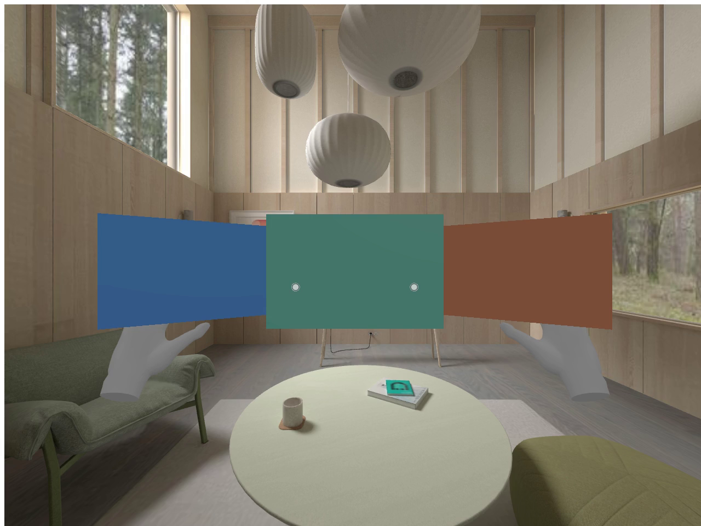
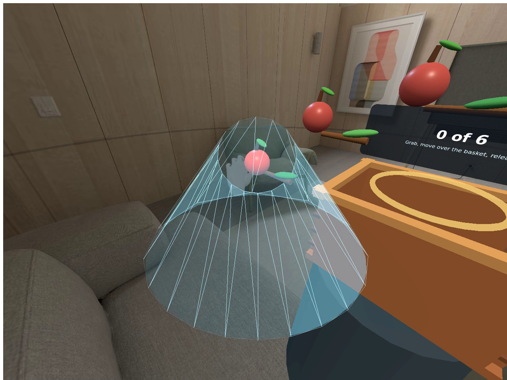
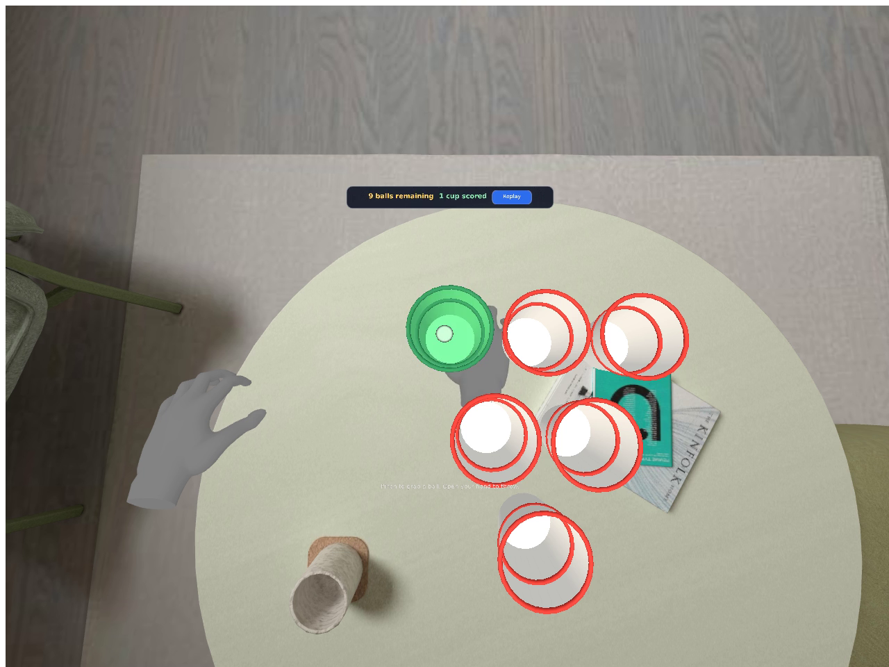
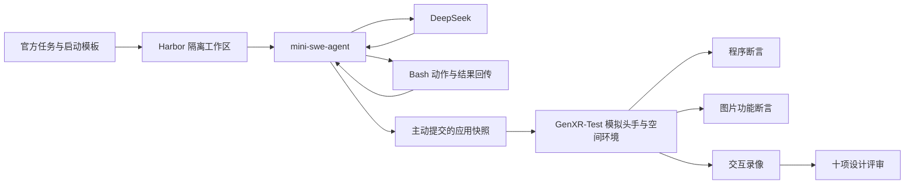

# GenXR-Bench 独立复现

[English](README.md) · **简体中文**

给 Coding Agent 一份空间交互设计要求，它能否独立写出一个会对用户手势作出正确响应的 XR 应用？本项目选取三项官方 App Generation 任务，保留从第一次作业到实际代码、官方功能断言和视觉评审的证据。GenXR-Bench 原作者的工作见[官方源码](https://github.com/whuang37/genxr-bench/tree/ea31e2c2b23884f7ab810de31a755b273e996770)和[论文](https://arxiv.org/abs/2610.29014v2)。

**三个应用均由 Agent 自主生成、主动提交并成功启动。其中一项完整通过官方功能评测。** 另外两项各有一条明确失败的必要程序断言，首次整题评测均为 invalid。仓库保留三项任务和四次作业。[统一结果](results/cohort.csv) · [作业记录](results/job-attempts.json)

## 三款应用的实际画面

| Focus Mode | Orchard Reach | Digital Beerpong |
|---|---|---|
| [](media/focus-mode/focus-mode-left.mp4) | [](media/orchard-reach/orchard-reach-basket-left.mp4) | [](media/digital-beerpong/digital-beerpong-right.mp4) |

点击图片可打开对应原始录像。三项任务分别要求用户在虚拟工作台移动屏幕、沿康复训练通道把苹果送入篮筐、用手的投掷速度控制球的运动。十段录像同时保留成功和失败的动作。[录像与文件指纹](media/manifest.csv) · [封存代码](apps/snapshot-hashes.json)

## 论文问题与复现方法

Huang 等人提出了 112 项 XR 编程任务，其中 67 项要求从头生成应用。GenXR-Test 在模拟房间里控制头部和双手，由程序读取三维位置、对象数量等状态，并把部分截图交给视觉裁判。独立的录像裁判按十项量表评价设计。这个机制能检验普通网页预览很难回答的问题，例如用户抬手后，屏幕究竟移动了多少厘米。[论文第 3、4 节](https://arxiv.org/html/2610.29014v2) · [源码学习入口](docs/source-guide.md)



三题在生成前选定，分属不同应用领域，易、中、难各一题，每题至少有一个可本地检查的交互行为。Harbor 0.18.0 调用 mini-swe-agent 2.4.6，模型来自 DeepSeek 官方接口，响应标识为 `deepseek-flash`。Thinking 开启，请求 `xhigh`，服务商文档说明实际映射到 `high`。单任务最多 128 次请求、120 分钟、估算费用 1.50 美元，各层自动重试为零。沿用官方任务、系统提示及 Bash 工具定义，生成结束后才挂载评测文件。[冻结配置](config/protocol.json) · [运行与复核指南](docs/reproduce.md)

## 官方功能结果与补充视觉评审

| 任务 | 首次实际生成应用的必要功能证据 | 首次官方成绩 | 网页十项原始均分 |
|---|---|---|---:|
| Focus Mode · 易 | 左右手均能移动三块屏幕，每块净位移超过 3 厘米 | valid，2/2，reward 1 | 3.50/5 |
| Orchard Reach · 中 | 抓住的苹果在检查点移动 0 米，要求超过 0.10 米。后续归枝检查未执行 | invalid，有效 reward 空缺 | 2.60/5 |
| Digital Beerpong · 难 | 左右手快投均比慢投移动得更远。独立的投失用例在一秒处要求找到一个带标签的球，实际为零 | invalid，有效 reward 空缺 | 5.00/5 |

Gemini 3.8 Flash 对独立采集的四份图片请求给出了 **3/4** 份原判。Orchard 左右手入篮联合断言均为 false。Digital 左手计分为 true，右手两次 HTTP 502。后续 Gemini 网页 Auto 对右手两图给出独立的 true。画面中目标杯变绿、剩余球数从 10 变 9、进杯数从 0 变 1，支持这次计分反馈。[逐份图片裁决](results/image-verdicts.json) · [首次官方用例](evaluation/first-cases.csv)

原版 API 录像 Design Score 取得 **0/3** 项。网页对每款应用均返回了十个评分，原分全部保留。三份判词均有理由与录像冲突，因此三项验收后的网页均分均留空。例如，Digital 的网页评审引用右手速度片第 8 秒说明球已清理，该帧的桌面上仍有橙球。网页 Auto 的底层版本与媒体处理参数无法独立核实。[十项评分与逐项验收](results/web-design.json) · [第 8 秒原帧](media/digital-beerpong/digital-beerpong-velocity-right-16-last-recorded.png)

## 生成效率

| 任务 | 模型轮数 | Bash 执行 | Tokens | Agent 时间 | 估算美元 | 近似测试/编辑比 |
|---|---:|---:|---:|---:|---:|---|
| Focus Mode | 30 | 49 | 1,670,843 | 3分42秒 | 0.02598 | 12/2 = 6.00 |
| Orchard Reach | 80 | 98 | 9,204,257 | 12分46秒 | 0.17904 | 34/19 = 1.79 |
| Digital Beerpong | 117 | 133 | 16,725,934 | 19分40秒 | 0.25033 | 36/39 = 0.92 |
| **合计** | **227** | **280** | **27,601,034** | **36分08秒** | **0.45535** | |

每个模型轮次由一次实际请求和一次保存的回复配对；一次回复可以发出多条 Bash 命令。时间为三次生成区间之和。费用由逐轮用量及当时时段单价估算，逐笔账单未知。T/E 以编写或执行自测的轮数除以编辑轮数，是可复查的近似值。[逐轮轨迹](trajectories/) · [计算方法](docs/reproduce.md#metrics)

## 解读范围

Orchard 第一次作业在本地编码 HTTP 请求头时中断，当时尚未发送模型请求。独立的第二次作业是该题首次实际模型生成。按首次作业计，交付 **2/3**；按首次实际模型生成计，交付 **3/3**。一题完整通过，另两题各有已知必要功能失败。两项完整有效 reward 和三题按官方有效成绩计算的 Pass@1 仍缺失。论文表 3 的 DeepSeek 行在 67 项 App 上报告 Pass@1 为 40.3%、设计均分 3.81。选题方式、推理配置、预算和裁判覆盖限制了数值比较。[论文表 3](https://arxiv.org/html/2610.29014v2#S4.T3) · [单列的历史案例](analysis/history.md)

## 在本机复核

```sh
python scripts/verify.py
```

这条命令只使用 Python 标准库，离线核对文件指纹，从逐轮记录重算三题总量，并检查各类成绩的独立字段。使用原版程序重新检查封存应用的命令及适用条件见[复现指南](docs/reproduce.md)。

| 目录 | 可查看的材料 |
|---|---|
| [apps](apps/) · [config](config/) | 原始应用快照、启动模板归属和运行配置 |
| [trajectories](trajectories/) · [results](results/) | 脱敏的逐轮模型和工具记录、作业口径、用量与评分 |
| [evaluation](evaluation/) · [media](media/) | 分手别的首次官方结果、逐条断言、实录和原图 |
| [analysis](analysis/) · [docs](docs/) | 历史案例、局限、源码学习索引和复核步骤 |

## 引用与致谢

感谢 William Huang 等 GenXR-Bench 作者、XR Blocks 和场景素材贡献者、WebXR Input Profiles 贡献者，以及 Harbor、mini-swe-agent 的开发者。三个应用包含 AI 生成代码，启动模板和房间、手模型均标明原始来源及许可。[官方主页](https://whuang37.github.io/genxr-bench/) · [XR Blocks](https://github.com/google/xrblocks) · [DevTools](https://github.com/xrblocks/xrblocks-devtools) · [素材与许可](docs/rights.md) · [引用本复现](CITATION.cff) · [公开发布检查](docs/release-audit.md)
